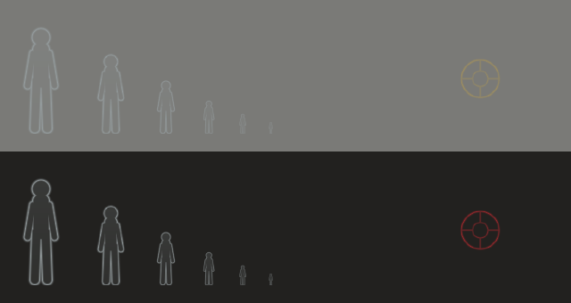

# Silent Hill Online

A branch of the PC port where other people are in your Silent Hill.

> There are two online systems here and they are independent. This page is the
> **master server**: ghosts and messages from strangers, no accounts, anyone can
> host one. For **Steam sessions** — friend invites, the overlay, and the link
> co-op will run on — see [Online_Steam.md](Online_Steam.md).
>
> [Online_Roadmap.md](Online_Roadmap.md) has what works today, what is next, and
> every testing recipe in one place.

This page is the living world, not co-op. Here you are still playing the game
alone, and nothing a stranger does can touch your world: no shared enemies, no
shared items, no shared doors. What you get is the sense that the town is
inhabited: pale outlines moving through the fog where somebody else is walking
right now, messages left on the floor, and the spots where other people died.

For playing *together*, with shared monsters, items and progress, see
[Online_Coop.md](Online_Coop.md).

Everything here is dormant unless `online_enabled = 1`. With it off, the build
opens no socket, starts no thread, and behaves exactly like the offline port.

---

## Running it

### 1. Start a master server

Ready-made builds of the server for Windows and Linux, with scripts that
install it on a VPS as a self-restarting service and open its admin console,
are on the [server release](https://github.com/SlickAmogus/silenthill-online/releases/tag/server);
`online_server/host/README.md` walks through them. By hand:

```
online_server/sh_master.exe -n "Fog" -m "Welcome to Silent Hill"
```

It listens on UDP 27888. For friends outside your network, forward UDP 27888
to the machine running it; on a LAN nothing needs forwarding.

| flag | meaning |
|---|---|
| `-p PORT` | listen port (default 27888) |
| `--ws PORT` | also take browser players over WebSocket on TCP `PORT` (see below) |
| `-n NAME` | server name players see |
| `-m TEXT` | message of the day |
| `-w WORD` | require a password |
| `-d FILE` | marker store path (default `memos.db`) |
| `--max N` | player cap (default 512, up to 1024); living world and co-op rooms share it |
| `-i N` | players allowed from one IP address (default 8; raise it for a LAN party behind one router) |
| `--no-ghosts` / `--no-memos` / `--no-deaths` | serve a subset |
| `-v` | log every query |

Markers are saved to `memos.db` — plain text, one per line, so a bad one can
be deleted with a text editor. It is written every 30 seconds when something
changed, and on a clean shutdown (Ctrl-C).

### Running the server: admin commands

While the server runs, open its console from the same machine:

```
sh_master --console
sh_master --cmd "players"        # or one command at a time
```

| command | does |
|---|---|
| `players` | who is on, with ids, addresses, rooms and builds |
| `kick <id or name> [reason]` | removes a player; they can reconnect |
| `ban <id, name or IP> [minutes] [reason]` | bans by address and by player id; no minutes means forever |
| `unban <IP or uid>`, `bans` | lift a ban, list them |
| `memos [name or uid]` | marker counts per player, or one player's markers |
| `prune old <days>` | deletes markers older than that |
| `prune user <name or uid>` | deletes every marker a player placed |
| `prune id <marker id>`, `prune deaths [days]` | one marker, or death markers |
| `prune all` | every marker: a clean world, for example before a release |
| `say <text>` | a message to everyone online |
| `save` | writes the marker store now |

The console listens on 127.0.0.1 port 27891 only (`--admin PORT` moves it,
`--admin 0` turns it off), so only someone logged in to the server machine
can use it. Bans are kept in `bans.txt` next to the marker store. Pruned
markers disappear for players already on that map the next time they change
map.

### 2. Point the game at it

In `config.cfg`:

```
online_enabled = 1
online_server  = 127.0.0.1
online_port    = 27888
online_name    = Harry
```

`net` in the in-game console reports the connection at any time.

### Browser players

A browser cannot send UDP, so the web build sends the same packets over a
WebSocket instead, and the server needs to be listening for them:

```
sh_master -n "Fog" --ws 27890
```

A page served over https can only open secure WebSockets (`wss://`), so put a
TLS reverse proxy in front of that port. With Caddy, which fetches the
certificate by itself, the whole Caddyfile is:

```
server.example.com {
    reverse_proxy 127.0.0.1:27890
}
```

The web build turns the server name into `wss://<server>/`. If your proxy
sits somewhere else, type the full address as the server instead, for example
`wss://example.com:8443/sh`. Behind the proxy the server reads each player's
real address from `X-Forwarded-For`, so the per-address limit still works. It
only trusts that header when the connection comes from the same machine.

Browser players get the living world and rooms on the server. They can't host
on their own machine, join by IP, or use Steam.

---

## What you see



**It is seamless.** You do not connect to the living world, you are just in it.
There is no lobby, no waiting and no banner — the client resolves and connects
in the background while you play, and reconnects the same way. Something only
appears on screen if the server refused you outright, or has stayed unreachable
for fifteen seconds. `F11` tells the truth whenever you want it.

**Ghosts.** Other players on the same map, drawn as hollow humanoid outlines.
They occlude behind walls and fade into the fog exactly as world geometry
does, because they go through the game's own ordering table rather than being
pasted over the frame. A ghost hides during cutscenes and menus — during a
cutscene the other player is standing where the camera put them, not where
they walked.

**Messages.** Press `M` to leave one. You pick a phrase and a word from two
lists; there is no typing, which is deliberate — nothing to moderate, nothing
to translate at runtime, and a message costs four bytes on the wire. Walk over
somebody's message to read it.

**Death markers.** Placed automatically where you die, and visible to
everyone. Turn them off with `online_deaths = 0` if you would rather not know.

**The player list.** `F11`. Everyone connected, the area they are in, and
their ping.

---

## Keys

| key | what |
|---|---|
| `F11` | who is online |
| `M` | leave a message |
| arrows / Enter / Esc | drive the composer (pad works too) |

Both are `key_online_players` and `key_online_memo` in `config.cfg`.

---

## Console

```
net             connection, ghost and marker counts
net who         the roster, with areas and pings
net reconnect   drop and re-join
net memos       re-query this map's markers

steam           Steam session, and the round-trip time to each member
steam host      open a co-op lobby (friends only)
steam invite    Steam overlay friend invite
steam join <id> | steam leave
```

---

## How it fits together

```
   your game                      master server                other players
 ┌──────────────┐   STATE 10Hz   ┌───────────────┐  SNAPSHOT  ┌──────────────┐
 │ sh_net_game  │ ─────────────▶ │  roster, by   │ ─────────▶ │              │
 │  reads       │                │  map          │            │              │
 │  g_SysWork   │ ◀───────────── │               │ ◀───────── │              │
 └──────────────┘   SNAPSHOT     │  marker store │   STATE    └──────────────┘
        │                        │  (memos.db)   │
        ▼                        └───────────────┘
 ┌──────────────┐
 │ sh_net_ghost │  draws into OT0, beside the bullet decals
 └──────────────┘
```

| file | job |
|---|---|
| `pc_port/include/sh_net_proto.h` | the wire format. Compiled verbatim by both ends |
| `pc_port/src/net/sh_net_platform.c` | the only file that sees winsock |
| `pc_port/src/net/sh_net_client.c` | protocol state machine, on a worker thread |
| `pc_port/src/net/sh_net_game.c` | the only file that reads `g_SysWork` |
| `pc_port/src/net/sh_net_ghost.c` | ghosts and markers, into the world OT |
| `pc_port/src/net/sh_net_art.c` | the generated silhouette and sigil |
| `pc_port/src/net/sh_net_memo.c` | phrase tables and the composer |
| `pc_port/src/net/sh_net_ui.c` | player list, composer, feed |
| `online_server/sh_master.c` | the server |
| `online_server/shnet_selftest.c` | drives a live server with two fake players |
| `pc_port/src/net/sh_net_steam.c` | Steam, loaded at runtime (Online_Steam.md) |
| `pc_port/src/net/sh_net_session.c` | Steam lobby lifecycle and the peer link |
| `online_server/steam_probe.c` | validates the Steam layer against a real DLL |

The socket lives on its own thread, so a server that has gone away cannot
stall a frame. It publishes into a game-thread-private copy once per frame,
and every reader after that — including the renderer — works off that copy
with no lock at all.

---

## Testing without a second machine

```
sh_master.exe -p 27899 -d selftest.db -v
shnet_selftest.exe 127.0.0.1 27899
```

The self-test drives the server with two synthetic players and checks the
handshake, the ping, position fan-out with map isolation, roster paging,
marker placement and read-back, death de-duplication, and that a `STATE`
carrying somebody else's session from the wrong address is ignored.

To run every check over WebSocket, the way the browser build connects:

```
sh_master.exe -p 27899 --ws 27900 -d selftest.db -i 100 --max 128
shnet_selftest.exe --ws 27900 127.0.0.1 27899
```

To see the generated art without launching anything:

```
ghost_art_dump.exe      # ghost.png, marker.png, contact.png
```

`contact.png` is a contact sheet of the silhouette at the sizes it is actually
seen at, over both fog and a dark interior.

---

## Limits, honestly

- **Only ever tested on one machine.** Two copies of the game, running at once
  against one `sh_master`, do connect and do see each other — the log shows
  each one reporting the other appearing at a plausible world position, and
  the ghost texture registering from inside the world draw. What has not been
  tried is two *different* machines, across a real network, with real latency
  and a NAT in the way. Expect that session to find things.
- **Nobody has looked at a ghost in the scene yet.** The silhouette was tuned
  by rendering it (`ghost_art_dump`), and every step up to the draw call is
  verified, but whether it reads well standing in a Silent Hill corridor is a
  question only a person can answer.
- No name tags over ghosts. Projecting a world position into the overlay's
  coordinate space is a known trap in this port (the widescreen/Hor+ framing
  work), and it is not worth risking for v1. Names are in the player list.
- Ghosts are silhouettes, not character models. Drawing another player's
  actual body needs their model resident, which the chara pool could do —
  a later step.
- No voice, no text chat, no shared state of any kind. By design.
- Markers are per-map, not per-room, so a marker on another floor of the same
  map is still in your list. It is range-culled before it is drawn.

## Not yet, but designed for

The protocol already carries a second clause for messages (`phraseB`/`wordB`),
a `SAVE` marker kind, and a per-player character id, none of which the client
uses yet. The `online_ghost_style` setting has a slot for drawing real models.
None of that needs a protocol version bump.
